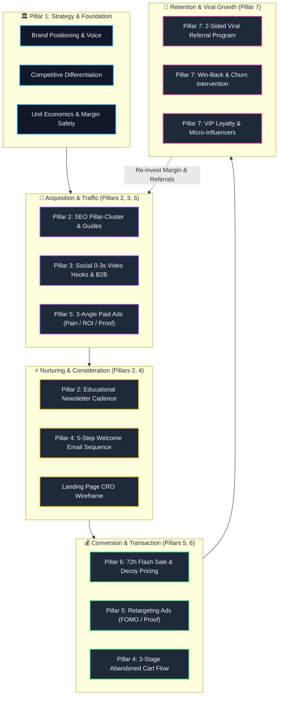
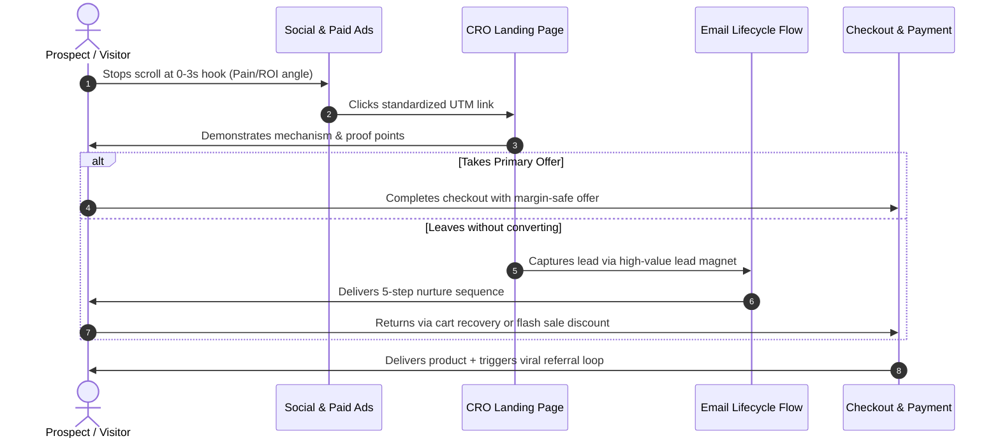

<!-- last-verified: 2026-09-09 -->
# Memory: campaign-mindmap

Mermaid visual architecture illustrating the 7 marketing pillars, audience progression, and conversion loops within the TidyFactor Marketing Engine.

---

## 1. 360° Growth & Pillar Architecture

---

## 2. Lead Journey & Signal Progression

